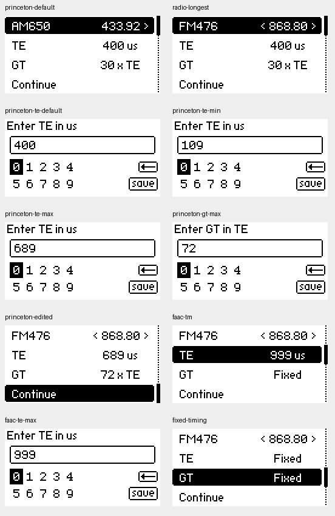

# Upstream review and selective Dev integration — 16 November 2026

Own source boundary: Dev `e01d8c24b8c6eac1f7e133ef1b6f288edff3a185`,
Stable010/main `b3e9aacd75a342d66fd0f9dea0467b1217726a59`.
Main is an ancestor of Dev (0/2 commits); their trees are identical before this
work. This is a source integration, **not a new tag or a Stable replacement**.

## Fresh source inventory

| Source | Exact reviewed head | Result |
| --- | --- | --- |
| [Official dev](https://github.com/flipperdevices/flipperzero-firmware/commit/a8a24de3ff394f77d599ea8ba9c073398670c880) | `a8a24de3ff394f77d599ea8ba9c073398670c880` | Selected concrete PVS findings; release1.5.1 unchanged |
| [Unleashed dev](https://github.com/DarkFlippers/unleashed-firmware/commit/53818b18f63e105baaf37ed8eac9a7def58ec8b1) | `53818b18f63e105baaf37ed8eac9a7def58ec8b1` | New code since reviewed `e43be5aff70b`; Stable095 unchanged |
| [ARF main](https://github.com/D4C1-Labs/Flipper-ARF/commit/7e3d1081d0c1e5227a3b148c472fa43ddedbcdc6) | `7e3d1081d0c1e5227a3b148c472fa43ddedbcdc6` | No new code since our previous review |
| [Momentum dev](https://github.com/Next-Flip/Momentum-Firmware/commit/d3f89dfe2ef6b01839201598e9be1590cba80322) | `d3f89dfe2ef6b01839201598e9be1590cba80322` | No new code |
| ProtoPirate main (actual forge fetched) | `dc3446b99f0174302c3d83c73b2dce0868024d39` | No new code |
| Marauder | `v1.20.0` | No new release |
| [Community16nov2026](https://github.com/xMasterX/all-the-plugins/releases/tag/16nov2026) | `e4b45b417478da2318afdda92b26166de66188fe` | UHF Expansion1.8 and USB I2S1.0; remain Community applications |

## Adapted, not blindly cherry-picked

- **Internal CLI radio:** a device without an optional begin hook succeeds;
  external CC1101 begin failures still propagate. This corrects the local CLI
  path without replacing the radio broker/diversity architecture.
- **NFC:** parenthesize PPS macro arguments and log Type4 length/status using
  their actual integer widths. Ultralight's legacy public fields already have
  the correct append-only layout here; compile-time offset guards now reject
  future insertions ahead of those fields. Do not transplant another layout,
  add PVS suppression comments or rename our public API to upstream's version.
- **Add Manually:** keep existing quick presets, menu IDs and remembered rows.
  Advanced now opens one stock VariableItemList before the existing KEY/Serial
  steps. It offers 15 canonical frequency/modulation pairs, bounded Princeton
  TE109–689us / GT15–72TE, and FAAC TM TE101–999us. Numeric input is allocated
  lazily, reused only in this scene and detached before freeing. Add a static
  12-DIP FAAC TM creation option; its existing Core codec is required. Guard-time
  persistence failures abort generation instead of showing a false success.
  Cancelled KEY edits restore the original numeric value; confirming the edit
  retains the selected TE/GT. Legacy isolated ARF profiles keep their existing
  generator layout through the explicit Core-only compile flag.
- **BelKorn:** separate Core **receive-only FAL**, adapted from the final
  Unleashed sequence `edc19780ed` / `53ff663b65` / `1a5676a0a6` rather than its
  discarded manufacturer inference. Require a full118-bit frame, a valid
  sync/button/tail, a trailing pulse/gap and two matching frames. Retain both
  words and full36-bit displayed serial; ignore incomplete/noisy input without
  overwriting the last confirmed capture. Save upstream `Data`; accept guarded
  legacy `Key2` only when its width and any duplicate field agree. No encoder,
  enrollment, seed search, speculative counter recovery or transmitter is added.
- **DEA Mio:** retain a received nonzero discriminator's flags only when its
  low serial byte agrees. Save the metadata and feed it to the existing encoder;
  preserve the legacy fallback for absent metadata and zero-discriminator RX.
  `Seed: 0` stays the pre-existing unknown sentinel, not a new file-format flag.
  Existing button/counter/crypto behavior is not expanded.
- **RX history:** name validated CAME25/18, FAAC/Genius and Nice variants without
  rewriting their saved Protocol/Key. CAME42 is not relabelled as static Prastel;
  our separate dynamic Prastel stays intact. RAM-ring pruning in both Standard
  and ARF cannot overwrite a pending RXDone notification. This does not delete
  saved files and does not explain historic missing SD recordings.

Upstream already-covered case renaming and earlier fixes are not re-ported.
Previously deferred TM01x finalization, enrollment and unrelated credential
tooling remain outside this adaptation. No user data or functions are removed.

## Community and compatibility boundary

USB I2S1.0 (MIT, MMX2026) is an external-DAC/I2S GPIO USB Audio Class application;
it is not a firmware audio driver or a new core dependency. UHF Expansion1.8
targets the MTools expansion board and adds region/frequency configuration and
readback. It is not interchangeable with our read-only Tumo UHF Inventory.
Neither app is a protected local replacement; do not duplicate them into FW
Packages or silently apply one board's settings to another.

The canonical Community ABI report binds all440 binaries to the exact
16nov2026 archives and our unchanged88.23 exports:394 compatible,41 host-contract
reviews,3 intentional GPS exclusions and2 existing missing firmware imports.
The two new apps are in the index and absent from incompatibility findings;
this is an import check, not physical/DMA/audio/RF acceptance. Protected audit
#205 is still pending; no protected acceptance baseline or exclusion is changed.

Public F7 API remains **88.23**. Private Sub-GHz feature ABI advances
**1004→1005** for the changed GenInfo layout and appended scene handlers. Old
feature FALs must fail closed, not load against the changed host. A future
firmware publication must ship the rebuilt native resources and an independently
verified matching FW Package snapshot (including46 protocol FALs). Do not activate
a package catalog referencing this unpublished integration build. Current
Stable007/Dev031 catalogs, iOS1.11.36 and their published assets are untouched.

## Reproduction and limits

```sh
python3 -m unittest tools.tumoflip.test_upstream_20261116 \
  tools.tumoflip.test_manual_parameters tools.tumoflip.test_belkorn_rx \
  tools.tumoflip.test_dea_mio_metadata tools.tumoflip.test_rx_labels_20261116
python3 -m tools.tumoflip.measure_upstream_20261116
python3 -m tools.tumoflip.render_manual_native /tmp/tumo-manual-ui
```

The native fixtures execute extracted production C with fatal ASan/UBSan.
Named-function region coverage excludes mocks, compile-only layout/log guards,
whole-firmware and RF behavior. The renderer captures labels/values/bounds from
the actual scene constructor and uses the **stock** VariableItemList/NumberInput
callbacks and firmware U8g2 fonts, not Weather's customized list. Values are split
into modulation and MHz columns so every radio option fits at128x64 without
scrolling. Ten states cover defaults, the longest choice, numeric limits, FAAC TM,
Continue and fixed-timing protocols.



Normal F7 build uses pinned toolchain39 and `-j2`; the physical C2 erase-page
reserve remains at least4096 bytes without a gate relaxation. Actual DfuSe,
native archive, feature-host/public-only FAL imports and the full host suite must
pass again on the final source. Exact results are kept in the task receipts.
CI is required before merging to Dev. No new release, real Flipper/SD changes,
fresh independent review or hardware acceptance are claimed by this document.

Manual acceptance remains: own BelKorn captures/old files; saved DEA Mio metadata
on a controlled receiver; quick and Advanced generation/back/cancel/save with
matching native resources; Standard/ARF history notifications; external radio
failure handling; optional UHF/DAC hardware on the correct board. Never run
write/error tests on the only copy of saved signals.
